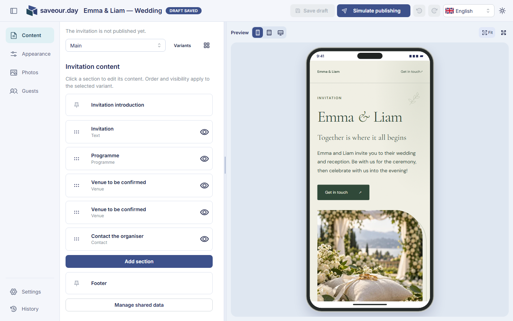
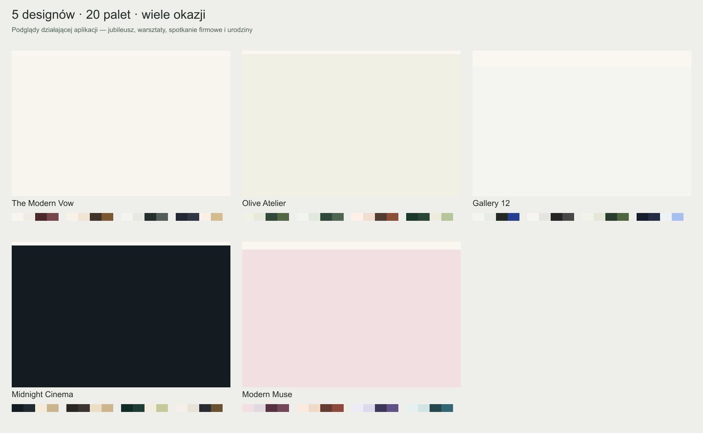
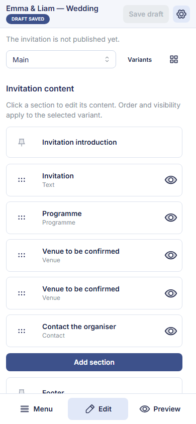
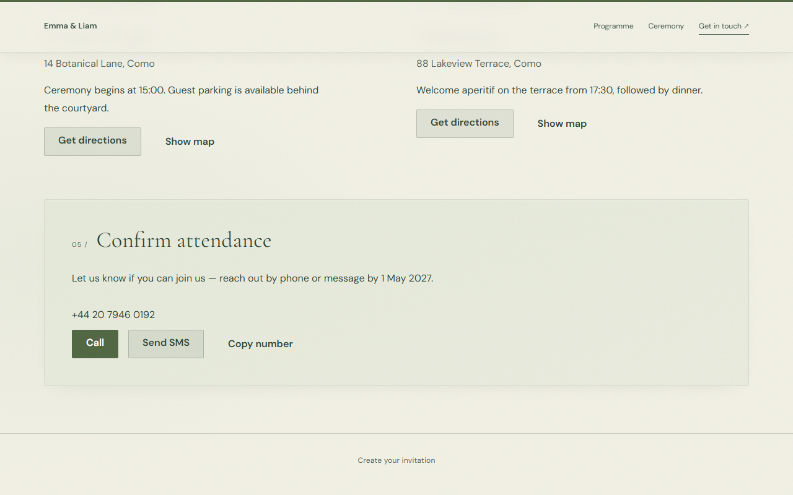
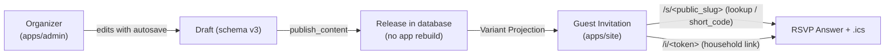

<div align="center">

<picture>
  <source media="(prefers-color-scheme: dark)" srcset="assets/brand/saveour-day-full-on-dark.svg" />
  <source media="(prefers-color-scheme: light)" srcset="assets/brand/saveour-day-full-on-light.svg" />
  
</picture>

<p>
  <strong>Event invitations, audience variants &amp; RSVP tracking — published in seconds without rebuilding.</strong>
</p>

<p>
  <a href="https://saveour-day-admin-production.vercel.app">Production Admin</a> &nbsp;&middot;&nbsp;
  <a href="#key-capabilities">Features</a> &nbsp;&middot;&nbsp;
  <a href="#themes--palettes">Themes</a> &nbsp;&middot;&nbsp;
  <a href="#how-it-works">Architecture</a> &nbsp;&middot;&nbsp;
  <a href="#quick-start">Quick Start</a> &nbsp;&middot;&nbsp;
  <a href="#documentation">Docs</a>
</p>

<p>
  <a href="https://github.com/andrev321/saveour-day/actions/workflows/checks.yml">
    
  </a>
  
  
  
</p>

</div>

<br />

<picture>
  <source media="(prefers-color-scheme: dark)" srcset="docs/images/admin-editor-desktop-dark.png" />
  <source media="(prefers-color-scheme: light)" srcset="docs/images/admin-editor-desktop-light.png" />
  
</picture>

## Key capabilities

- **Contextual editor & live preview** — Autosaved v3 drafts, undo/redo, drag-and-drop sections, device-specific photo crops, and live phone/tablet/desktop previews.
- **Audience variant projection** — Maintain one invitation with multiple audience variants; server-side projection filters hidden sections and schedule items per guest group.
- **Zero-rebuild releases** — Publishing writes a versioned release to PostgreSQL so guest pages update immediately without redeploying the app.
- **Flexible access & RSVP** — Public links, shared access codes, household `/i/<token>` links, email OTP verification, custom RSVP questions, and `.ics` calendar export.
- **10 starter templates (PL / EN / DE)** — Weddings, birthdays, corporate events, workshops, baby showers, housewarmings, or a clean blank draft.
- **5 themes & 20 palettes** — WCAG-verified contrast (4.5:1+ text/accent), custom color overrides, and bundled WebP sample scenes.

## Themes & palettes

Every starter template works with any of the five built-in designs and twenty color palettes (see [Themes and palettes](docs/THEMES-AND-PALETTES.md)):



## Mobile editor & guest experience

| Mobile editor (`390 px`)                                                                   | Guest confirmation & venue details                                                                      |
| ------------------------------------------------------------------------------------------ | ------------------------------------------------------------------------------------------------------- |
|  |  |

## How it works



## Environments

| Environment | Admin panel                                     | Access          |
| ----------- | ----------------------------------------------- | --------------- |
| Production  | https://saveour-day-admin-production.vercel.app | Public          |
| Staging     | Shared privately                                | On request only |

<details>
<summary>Staging tester access</summary>

Staging is protected by Vercel Authentication. To test there, ask the repository owner for access and provide your email address. The owner grants access per email in Vercel and shares the staging address after approval. See [Staging operations](docs/STAGING-OPERATIONS.md#tester-access).

</details>

## Quick start

Requires **Node.js 24** and **npm 11**.

```sh
npm ci
npm run dev        # Guest application → http://127.0.0.1:5173
npm run dev:admin  # Admin panel       → http://127.0.0.1:3000
```

**Zero-config local demo (no Supabase needed):**

- Admin editor demo: `http://127.0.0.1:3000/demo`
- Guest invitation demos: `http://127.0.0.1:5173/demo/main`, `/demo/full`, and `/demo/limited` (Polish aliases `/demo/glowna`, `/demo/pelna`, `/demo/ograniczona` also supported)

Admin demo data is temporary; simulated publication does not write to the database. Missing service settings never replace a real client's route with demo data.

<details>
<summary>Connecting Supabase &amp; Windows PowerShell notes</summary>

1. Copy `apps/admin/.env.example` to `apps/admin/.env.local` and `apps/site/.env.example` to `apps/site/.env.local`.
2. Configure services using the [deployment checklist](docs/DEPLOYMENT-CHECKLIST.md).
3. On Windows PowerShell, use `npm.cmd` if execution policy blocks `npm`, and `Copy-Item` to copy `.env.example` files.

</details>

## Repository map

| Path                  | Purpose                                                        |
| --------------------- | -------------------------------------------------------------- |
| `apps/admin`          | Organizer panel                                                |
| `apps/site`           | Guest invitations, authentication, media, and RSVP             |
| `packages/domain`     | Schema v3, validation, templates, themes, and guest projection |
| `packages/renderer`   | Shared invitation renderer                                     |
| `packages/ui`         | Branding and shared UI infrastructure                          |
| `supabase/migrations` | Database schema, permissions, and lifecycle operations         |
| `tests`               | Unit, integration, browser, and staging checks                 |

## Checks

```sh
npm run check     # Fast parallel check: format, typecheck, lint, boundaries, unit tests
npm run check:ci  # Full CI mirror: audit, uncached lint, Deno check, production build + E2E
```

<details>
<summary>Individual scripts &amp; regenerating documentation screenshots</summary>

```sh
npm run typecheck
npm run lint
npm test
npm run build
npm run build:admin
npm run test:e2e
npm run docs:screenshots  # Regenerate docs/images/* via Playwright
```

See [Testing](docs/TESTING.md) for browser installation, isolated PostgreSQL checks, CI, and staging smoke tests. Automated mocks do not verify real email delivery.

</details>

## Documentation

Start with the [documentation index](docs/README.md), or go directly to:

- [Architecture](docs/ARCHITECTURE.md) and [technical decisions](docs/TECHNICAL-DECISIONS.md)
- [Content editor](docs/CONTENT-EDITOR.md), [interface](docs/CONFIGURATOR-INTERFACE.md), and [editing/guest workflows](docs/product-review-improvements.md)
- [Starter templates](docs/STARTER-TEMPLATES.md) and [themes/palettes](docs/THEMES-AND-PALETTES.md)
- [Deployment checklist](docs/DEPLOYMENT-CHECKLIST.md), [deployment/acceptance guide](docs/PLATFORM-DEPLOYMENT.md), and [retention/media lifecycle](docs/SITE-DELETION.md)

## Brand assets

[Brand kit and usage](assets/brand/README.md) &middot; [light/dark/animation preview](assets/brand/index.html)

Regenerate with `npm run build:brand`.
