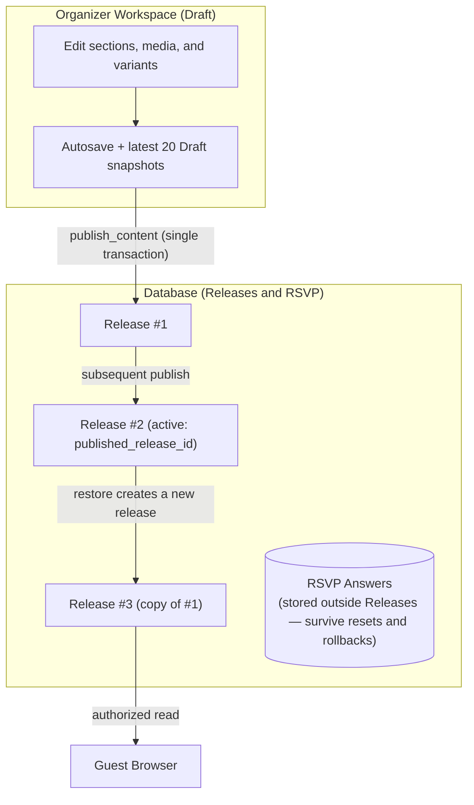
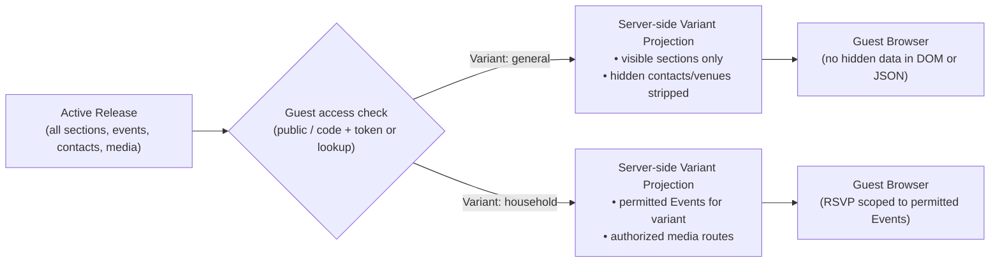

# Architecture

This document describes the repository implementation, not proof of a production rollout. For setup, see [Deployment](PLATFORM-DEPLOYMENT.md); for recorded environment checks, see [Staging status](STAGING-STATUS.md).

## Applications and shared packages

Each environment uses two Next.js projects and one Supabase project. All organizers share the application runtime; publishing an invitation does not create a deployment.

| Module | Responsibility |
| --- | --- |
| `apps/admin` | Organizer accounts, drafts, preview, media, publishing, guests, access settings, and RSVP management |
| `apps/site` | Published invitations, guest authentication, authorized content and media, RSVP, and calendar downloads |
| `packages/domain` | Zod schemas, content projection, templates, themes, and shared validation |
| `packages/renderer` | Shared React/Mantine rendering for preview and published invitations |
| `packages/ui` | Branding and the styled-components SSR/streaming registry |
| `supabase/migrations` | Tables, RLS, column permissions, transactional writes, sessions, rate limits, and retention |

The repository uses Next.js 16, React 19, TypeScript, Zod 4, Mantine 9, styled-components, Supabase, and Sharp. Use Node.js 24; `package-lock.json` is the source of exact dependency versions. Vite is no longer the application runtime.

## Core concepts

- A **site** is an organizer's event project: draft, releases, access settings, and stable public address.
- A **variant** defines its own ordered section placements, visibility, and permitted events.
- An **invitation** assigns one person or a group (with an optional group name) to a variant, with 1–20 guests (`named` or `companion`), an auto-generated 6-character `short_code`, `origin`/`review_status`, revocation state, and an RSVP revision.
- A **release** stores published configuration and media paths separately from the editable draft.

| Guest route | Purpose |
| --- | --- |
| `/s/<public_slug>` | General site entry point with optional guest self-lookup for RSVP |
| `/i/<token>` | Invitation link (pre-authorized RSVP) |
| `/demo/glowna`, `/demo/pelna`, `/demo/ograniczona` | Explicit demos without client data |

A site's slug combines its name with a UUID. Invitation tokens are random; only their hashes are stored. The original link is available when created or rotated, not recoverable later from the stored hash, while each invitation's 6-character `short_code` remains visible in the admin panel for manual sharing and collision disambiguation.

## Configuration and editor

The application accepts **schema v3 only**. Typed sections reference events, venues, contacts, or media. Every variant, including the default, has independent section order and visibility. Event permissions are separate from section visibility: hiding a timeline does not remove RSVP eligibility.

Hero and gallery crops belong to each use of an image, with desktop/tablet/mobile positions. Guest projection removes hidden sections and unrelated contacts, venues, and media before sending content to the browser. See [Content editor](CONTENT-EDITOR.md).

There are ten populated starter templates plus a blank template, in Polish, English, and German. Templates provide initial data, not separate application types. Visual themes and audience variants are independent. Resetting a template checks revisions and variant dependencies, saves the previous persisted draft, and assigns new event IDs. Existing invitations, RSVP history, access settings, and library files remain. See [Starter templates](STARTER-TEMPLATES.md).

The editor autosaves valid changes, provides undo/redo and recovery, and handles revision conflicts. Publishing is always separate. See [Editing and guest workflows](product-review-improvements.md).

## Publishing and rollback

Draft writes use revision checks. Publishing validates configuration and media, then `publish_content` checks permissions and revision, records a release, and updates `sites.published_release_id` in one transaction.

Publishing does not call Vercel or build code. Guests receive the active release on their next authorized read. Draft changes do not alter published content.

Restoring a previous publication creates another release. It does not roll back RSVP answers, access settings, or the draft. Missing variants referenced by active invitations or the general page can block restoration. Unpublishing clears the active-release pointer and invalidates site sessions.

A code deployment changes the shared renderer for every site; content releases do not pin an application version. The earlier v1/v2 runtime adapters have been removed. The one-time v3 migration converted drafts, releases, and snapshots, including archived sites. Migration history is retained; ordinary publication does not rewrite historical releases.

## Authentication and access

Organizers use Supabase email/password or Google OAuth authentication and must have a confirmed email before creating a site. `site_members` and `platform_admins` control access; a signed-in account is not automatically authorized for another site's data.

| Site access mode | General entry | Household link |
| --- | --- | --- |
| `public` | General variant + optional guest self-lookup | Invitation variant and RSVP |
| `code` | Shared site code | Invitation token plus the same code |

Codes use scrypt with a random salt. Guest sessions use random tokens in HttpOnly, SameSite=Lax cookies, Secure in production, with a seven-day lifetime. The database stores hashes and access versions. Guest browsers do not receive Supabase Auth tokens.

Changing site access, editing an invitation, rotating its link, or revoking it invalidates the relevant sessions. Code attempts and guest lookup attempts have database and IP rate limits. Mutations validate the request origin.

Guest APIs use a server-only privileged key, so handlers must enforce authorization themselves. SQL also checks site, invitation, guest, event, and session when saving RSVP. Guest content uses `private, no-store`, private media uses `private, no-cache` with server-revalidated `ETag` (`304 Not Modified` only after passing authorization checks), and pages use `noindex`. Revocation blocks future requests immediately but cannot erase copies already downloaded.

## Media

Uploads are a single authenticated request to the admin API. The server accepts non-animated JPEG, PNG, or WebP up to **8 MiB and 20 million pixels**, converts them with Sharp, and stores only processed WebP variants.

The upload uses the organizer's Storage client and a narrowly checked INSERT policy; privileged access must not bypass that policy. The library limit is 100 records, including unfinished uploads; at most five uploads may be in progress. Configuration references at most 30 images.

Admin and guest image reads go through authorized API routes. The current application does not issue signed Storage read/upload URLs. Guest reads also check the selected variant and published manifest. Bundled sample images are public, versioned assets accepted only through exact allowlisted manifests; they are distinct from private uploads.

Deletion reserves a terminal `deleting` state, removes Storage objects, and only then removes metadata. References from saved drafts, releases, or snapshots block deletion. See [Site deletion and media lifecycle](SITE-DELETION.md).

## RSVP and integrity

**Attendances** belong to a guest/event pair within an invitation, and **Question Answers** belong to an **RSVP Question** (scoped per guest or per invitation). Invitations support 1–20 guests (`named` or `companion`, at least one `named`), configuration up to 50 events and 20 organizer-defined RSVP questions, and notes up to 2,000 characters. No response is different from declining. A companion can attend an event only when at least one named guest on the same invitation attends that event.

On `/s/<public_slug>`, guests can look up their invitation by normalized full name of a **Named Guest** (diacritic-insensitive) or 6-character `short_code` without exposing a public guest list. Name collisions require disambiguation (`short_code` or another named guest), and already-answered invitations (`rsvp_revision > 0`) are locked against unauthenticated overwrites on other devices unless verified with `short_code` or `/i/<token>`.

Sites can also toggle **Info-Only Mode** (`rsvp_enabled = false`) to hide RSVP UI and block RSVP writes, or enable `allow_self_registration` so unlisted guests (optionally with one companion) submit into a `pending_match` queue for organizer approval or merge.

Revision checks reject stale submissions. Guest deadlines use Europe/Warsaw in the interface and `timestamptz` in the database. Organizers may correct answers after the deadline (bypassing `required` question checks), but an active publication is still required. Answers for temporarily hidden events or questions remain in the database.

Composite foreign keys include `site_id` to prevent cross-site relationships. Secret columns are unavailable to browser clients; sensitive writes use backend-only SQL functions and audit events.

Guest management supports CSV import/export, quick-add text import, collision warnings with 1-click copy (`link + code` or personal `/i/<token>` link), converting a companion to a named guest, organizer-defined RSVP questions with presets, and invitation-scoped calendar downloads. The platform does not send invitation or reminder emails to guests; organizers share generated links and codes via their preferred channel.

## Boundaries and verification

Per-site custom domains, payments, and outbound guest email campaigns are not implemented.

Automated checks cover domain behavior, SQL/RLS in PGlite, PostgreSQL concurrency, real API handlers with controlled external responses, and Playwright UI flows. See [Testing](TESTING.md) and the dated [publication review](PUBLICATION-SELF-REVIEW.md).
