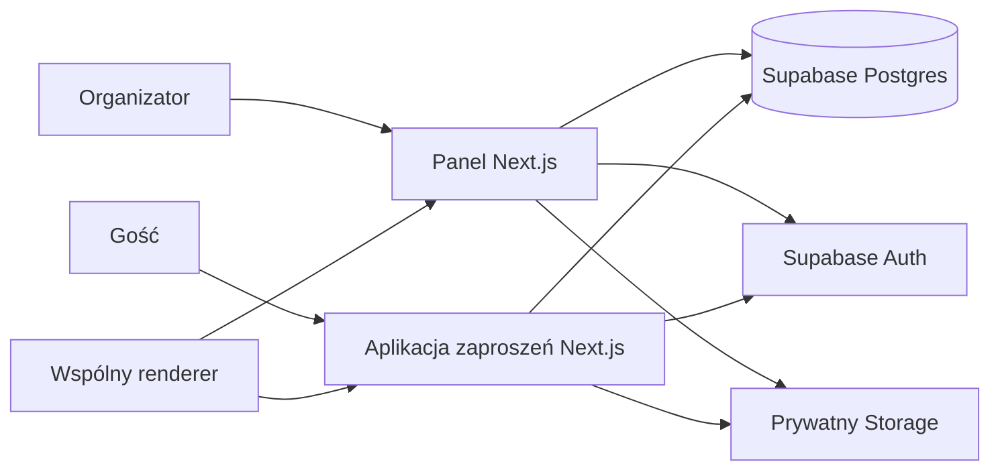

# Architektura platformy zaproszeń

Stan kodu: 2026-09-23. Dokument opisuje implementację w repozytorium. Nie potwierdza zastosowania migracji ani uruchomienia usług na produkcji. Czynności operacyjne opisuje [instrukcja wdrożenia](WDROZENIE-PLATFORMY.md), a uzasadnienia wyborów — [decyzje techniczne](DECYZJE-TECHNICZNE.md).

## Podział aplikacji

Platforma obsługuje wielu organizatorów i wiele realizacji we wspólnym runtime. Docelowa konfiguracja hostingu to dwa projekty Next.js na Vercel i jeden projekt Supabase na środowisko.

| Moduł | Odpowiedzialność |
| --- | --- |
| `apps/admin` | Rejestracja i logowanie organizatorów, edycja szkicu, podgląd, media, publikacja, zaproszenia, ustawienia dostępu i RSVP |
| `apps/site` | Odczyt publikacji, bramka dostępu gości, renderowanie wariantu, chronione zdjęcia i formularz RSVP |
| `packages/domain` | Schemat Zod, normalizacja konfiguracji, projekcja treści dla gości, wspólna walidacja RSVP, hashowanie kodów i tokenów |
| `packages/renderer` | Wspólny renderer React/Mantine dla podglądu i publikacji, motywy, responsywność i lokalne fonty |
| `supabase/migrations` | Tabele, RLS, uprawnienia kolumnowe, transakcje publikacji i RSVP, sesje gości i limity prób |

Stos zainstalowany w repozytorium: Next.js 16, React 19, TypeScript, Zod 4, Mantine 9, Supabase i Sharp. CI używa Node.js 24. Dokładne wersje określa `package-lock.json`. Vite nie uczestniczy w uruchamianiu ani budowaniu aplikacji.

## Realizacja, wariant i zaproszenie

- **Realizacja (`site`)** ma treści wydarzenia, szkic, historię wydań, ustawienia dostępu i stały adres.
- **Wariant treści** określa kolejność i widoczność wydarzeń oraz sekcji. Wariant główny jest nieusuwalny; normalizacja zachowuje w nim wszystkie wydarzenia i sekcje. Renderer uwzględnia również globalne włączenie sekcji.
- **Zaproszenie (`invitation`)** przypisuje osobę lub rodzinę do wariantu. Zawiera listę gości, dopuszczone e-maile, status cofnięcia i rewizję RSVP.

Wariant nie ma osobnego publicznego deploymentu ani ścieżki wybieranej swobodnie przez gościa. Pola identyfikatora i `slug` wariantu pozostają w schemacie, lecz aktualny routing ustala wariant z ustawień realizacji lub zaproszenia.

| Adres w aplikacji gości | Znaczenie |
| --- | --- |
| `/s/<public_slug>` | Stały adres realizacji; wariant ogólny lub bramka e-mail |
| `/i/<token>` | Link do osoby/rodziny; dodatkowe wymagania zależą od trybu dostępu |
| `/v/<invitation_id>` | Wybór zaproszenia po OTP; zawsze wymaga właściwej sesji |
| `/demo/glowna`, `/demo/pelna`, `/demo/ograniczona` | Jawne demonstracje bez danych klientów |

Nowa realizacja otrzymuje slug z nazwy i UUID. Token zaproszenia jest losowy, a baza przechowuje wyłącznie jego hash. Panel pokazuje link przy utworzeniu lub rotacji. Organizator sam przekazuje go odbiorcom.

## Szablony i szkice

Przy tworzeniu organizator wybiera jeden z 10 szablonów lub pusty start oraz język PL/EN/DE. Katalog w `packages/domain/src/templates.ts` dostarcza wartości początkowe zwykłej konfiguracji v2. Główny napis `identity.displayName` jest dowolnym tekstem; renderer nie wymaga pary osób ani typu wydarzenia. Motyw wizualny i wariant odbiorców są niezależne od szablonu. Workspace’y mają neutralny prefiks `@invitations/*`.

Zmiana szablonu w edytorze wymaga potwierdzenia. Backend kontroluje rewizję i zależności wariantów, zapisuje kopię ostatniego zapisanego szkicu w `draft_snapshots`, a następnie zastępuje szkic w jednej transakcji. Nowe wydarzenia otrzymują nowe ID, więc historyczne RSVP nie przechodzą na nowe wydarzenia. Publikacja, zaproszenia, ustawienia dostępu i biblioteka plików pozostają bez zmian. Panel umożliwia przywrócenie jednej z 20 najnowszych kopii.

Pusty szkic nie ma przykładowych danych ani wymaganych sekcji. Jego zapis jest dozwolony; publikacja wymaga głównego napisu. Zmiana języka panelu nie podmienia konfiguracji. Szczegóły użytkowe opisują [szablony startowe](SZABLONY-STARTOWE.md).

## Szkic i publikacja

Edycja zmienia `drafts.config` z kontrolą rewizji. Publikacja waliduje konfigurację i manifesty mediów, a funkcja `publish_content` w jednej transakcji sprawdza uprawnienia i zgodność rewizji, zapisuje niezmienne wydanie oraz ustawia `sites.published_release_id`. Wydanie zawiera konfigurację i mapę plików Storage.

Publikacja nie buduje kodu i nie wywołuje Vercel API. Gość otrzymuje aktualne wydanie przy kolejnym odczycie. Niezapisane zmiany i zapisany szkic nie wpływają na publikację.

Przywrócenie treści wcześniejszego wydania tworzy kolejne wydanie i przełącza publikację. Nie cofa RSVP, uprawnień ani szkicu. Operacja może zostać odrzucona, jeśli konfiguracja nie zawiera wariantu używanego przez aktywne zaproszenie lub stronę ogólną. Wycofanie publikacji usuwa wskaźnik aktywnego wydania i unieważnia sesje realizacji.

Wdrożenie kodu jest odrębną operacją i aktualizuje wspólny renderer wszystkich realizacji. Wydania treści nie przypinają osobnej wersji aplikacji; `engine_sha = shared-v1` oznacza obecny model publikacji. Nowe szkice i wydania używają schematu v2. Czytnik obsługuje także v1 przez adapter: `couple` przechodzi w `identity.displayName`, bez zmiany ID wydarzeń. Historyczne wydania nie są przepisywane.

## Autoryzacja i prywatność

Organizator używa konta Supabase Auth z e-mailem i hasłem. Założenie realizacji wymaga potwierdzonego e-maila. Dostęp do realizacji określają `site_members` i `platform_admins`; samo zalogowanie nie daje dostępu do cudzych danych. Tworzenie realizacji nie wymaga roli administratora platformy.

Tryb dostępu obejmuje całą realizację:

| Tryb | Wejście ogólne | Link rodzinny |
| --- | --- | --- |
| `public` | Odczyt wariantu ogólnego | Odczyt wariantu rodziny i możliwość RSVP |
| `code` | Wspólny kod realizacji | Token zaproszenia oraz ten sam kod |
| `email` | OTP dla dopuszczonego adresu, następnie wybór przypisanej rodziny | OTP dla adresu wpisanego w tym zaproszeniu |

Kod jest hashowany scrypt z losową solą. Gość po autoryzacji otrzymuje własną sesję aplikacji: losowy token w ciasteczku HttpOnly, SameSite=Lax, Secure w produkcji, ważny 7 dni. Baza przechowuje hash oraz wersje dostępu realizacji i zaproszenia. Tokeny Supabase Auth nie trafiają do przeglądarki gościa.

Zmiana ustawień dostępu, edycja zaproszenia, rotacja linku i cofnięcie dostępu unieważniają odpowiednie sesje przez kontrolę wersji. `/v/` nie staje się publiczne nawet po zmianie trybu na `public`. Limity kodu, wysyłki OTP i weryfikacji OTP są egzekwowane w bazie z dodatkowym limitem IP. Mutacje sprawdzają origin żądania.

API aplikacji gości używa serwerowego `service_role`; samo RLS nie zastępuje kontroli dostępu w tych handlerach. Projekcja `guestContent` usuwa inne warianty, ukryte wydarzenia i sekcje oraz niepotrzebne kontakty, lokalizacje i media przed wysłaniem konfiguracji do przeglądarki. SQL dodatkowo weryfikuje sesję, realizację, rodzinę i wydarzenia przy zapisie RSVP.

Treść i media gości mają `private, no-store`, a strony `noindex`. Cofnięcie uprawnień blokuje następne żądania; nie usuwa danych już pobranych przez odbiorcę.

## Media

Panel przygotowuje podpisany upload do prywatnego bucketa `site-media`. Finalizacja sprawdza format i rozmiar, tworzy warianty WebP przez Sharp oraz zapisuje manifest. Obsługiwane są nieanimowane JPEG, PNG i WebP do 8 MB oraz 20 milionów pikseli. Biblioteka ma limit 100 gotowych plików, konfiguracja — 30 mediów.

Podgląd organizatora korzysta z czasowych podpisanych URL-i. Goście pobierają zdjęcia przez `/api/media/<kind>/<key>/<asset>/<file>`. Handler sprawdza dostęp i obecność pliku w projekcji wariantu oraz manifeście publikacji, po czym pobiera go z Storage. Nie udostępnia gościom podpisanych URL-i ani publicznego optymalizatora zdjęć.

## RSVP i integralność danych

Odpowiedź dotyczy pary gość–wydarzenie w obrębie zaproszenia. Dopuszczony adres e-mail reprezentuje całą rodzinę. Zaproszenie ma do 20 gości, konfiguracja do 50 wydarzeń, a notatka do 2000 znaków. Brak odpowiedzi różni się od odmowy.

`save_rsvp` sprawdza rewizję i blokuje zapis nieaktualnego formularza. Goście mogą odpowiadać do terminu; panel interpretuje termin w strefie Europe/Warsaw, baza przechowuje `timestamptz`. Organizator może poprawiać odpowiedzi po terminie, ale zapis nadal wymaga aktywnej publikacji. Odpowiedzi na usunięte wydarzenia pozostają w bazie, a interfejs korzysta z aktualnie dostępnych wydarzeń.

Klucze obce obejmujące `site_id` chronią spójność powiązań między realizacjami. Sekretne kolumny nie są dostępne dla klienta przeglądarkowego. Nowe operacje zapisu są dostępne przez funkcje SQL wywoływane wyłącznie z backendu, a zmiany są rejestrowane w `audit_events`.

## Zakres i stan odbioru

W kodzie dostępne są samodzielna rejestracja, publikacja, trzy tryby dostępu, rodzinne zaproszenia i RSVP. Panel i szablony mają obsługę PL/EN/DE, ale nowe formularze dostępu, zarządzania gośćmi i RSVP nie mają jeszcze pełnego tłumaczenia — ich komunikaty są po polsku.

Własne domeny realizacji, płatności, automatyczne rozsyłanie zaproszeń i eksport RSVP nie są zaimplementowane. Panel eksportuje konfigurację JSON, ale nie oferuje formularza jej importu. Skrypt `import:legacy` jedynie konwertuje dawne dane lokalnie. Te ograniczenia nie stanowią zatwierdzonego harmonogramu kolejnych prac.

Testy obejmują SQL/RLS w PGlite, rzeczywiste handlery z kontrolowanymi usługami zewnętrznymi oraz interfejsy w Playwright. Odbiór rzeczywistego SMTP, Auth, Storage i migracji pozostaje czynnością wdrożeniową. Stan wykonanej kontroli opisuje datowany [raport self-review](SELF-REVIEW-PUBLIKACJI.md).
