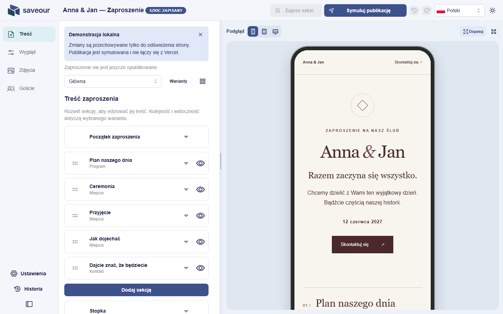
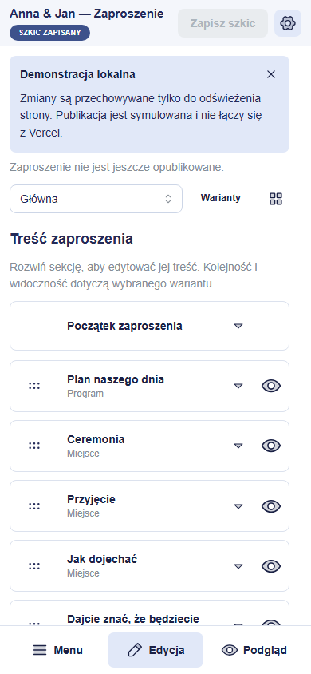

# Editor interface

The workspace separates Content, Appearance, Photos, and Guests, with Settings and History as tools. See [Content editor](CONTENT-EDITOR.md) for the data model and [Editing and guest workflows](product-review-improvements.md) for autosave and recovery.

The original layout direction was called Focus × Paper. The current panel uses saveour.day branding, indigo accents, and light/dark panel tokens; it no longer uses the original sage/cream palette. Panel appearance is independent of invitation themes. Icons use Phosphor Duotone.

## Adaptive layout

| Desktop (`1440 px`) | Mobile (`390 px`) |
| --- | --- |
|  |  |

| Window width | Behavior |
| --- | --- |
| 1600 px and above | Labeled navigation, 440–560 px form, remaining space for preview |
| 1100–1599 px | Narrower navigation, 380–460 px form, flexible preview |
| 768–1099 px | Edit/Preview switch and drawer navigation |
| Below 768 px | Single-column form, bottom Menu/Edit/Preview controls, save in the header, other actions in project options |

Desktop form and preview scroll independently. Navigation can collapse to icons with tooltips. Drag the divider or focus it and use arrows/Home/End; the preferred width is clamped to the current screen.

Preview presets are Phone (390 px), Tablet (768 px), and Desktop (1440 px); a previously saved 320 px width remains supported. The toolbar includes device, variant, fit, and expand/close controls. Phone/tablet previews use a device frame with a single rounded clipping mask.

Fit scales the whole device to the available width and height while keeping the iframe's actual width and invitation breakpoints. Turning fit off uses 100% scale and scrolling. Expanded preview fills the viewport and responds to resizing.

Layout reset is available below navigation and in the mobile menu. Browser zoom remains available; the workspace reacts to `visualViewport` when the on-screen keyboard opens.

## Photos and crops

The library handles uploads, descriptions, and files. Crop controls belong to the hero or gallery use. The same image can have different crops in each use and on each device. Drag the crop or use arrows; Home or Center crop restores the center. The theme and device determine the final crop shape.

Remove from invitation clears hero/gallery references while keeping the library file. Save and publish to update guests. A configuration can contain at most 30 images; further uploads may remain in the library.

Delete from library permanently removes the upload and its sizes after confirmation. First remove current draft references and save. The database also blocks deletion when any release or draft snapshot still references the asset.

Deletion reserves `deleting`, removes Storage objects, then deletes metadata. If Storage fails, retry the visible pending operation. Do not manually reset it to `ready`: some objects may already be gone.

Images now load through authorized application APIs, not signed Storage links. The renderer associates fetch failures with the current source set so changing or refreshing a source can recover. Regression coverage includes `photo-recovery.spec.ts` and `photo-library.spec.ts`. Full lifecycle details: [Site deletion and media lifecycle](SITE-DELETION.md).

## Preferences and accessibility

- Device-local layout preferences use localStorage keys beginning `invitations-view-v1-`: form width, collapsed navigation, preview width, and fit.
- Preferences are not invitation configuration, draft, or publication data.
- Switching Edit/Preview retains field values, expanded sections, and scroll position.
- Reduced-motion preferences disable decorative transitions.
- Section drag handles are separate from expand/collapse controls.
- Template reset opens a shared create/reset dialog with an explicit warning and confirmation. Draft snapshots are in Settings.
- Panel light/dark styling does not recolor the invitation iframe.

## Implementation

`EditorWorkspace` owns layout, navigation, and preferences. `PreviewCanvas` measures available space with ResizeObserver. `PanelTheme` supplies Mantine colors and icon defaults. `Editor` owns editing, saving, publishing, and preview communication.

Most custom styles use styled-components, grouped in modules such as `workspace.styles.ts`, `preview.styles.ts`, and `fields.styles.ts`. The panel also has `apps/admin/app/panel-colors.css`; library styles and fonts remain external package imports. Both applications use `StyledRegistry` from `@invitations/ui/registry` and the Next.js styled-components compiler so server-rendered HTML includes styles before hydration.

Tests prefer roles and stable `data-ui` attributes over generated class hashes. Workspace E2E cover 320–2560 px, editing, mobile navigation, preview scaling, keyboard resizing, preference persistence/reset, and reduced motion.

The contextual editor requires the v3 migration and coordinated deployments of both applications; it introduced no new environment variables.
