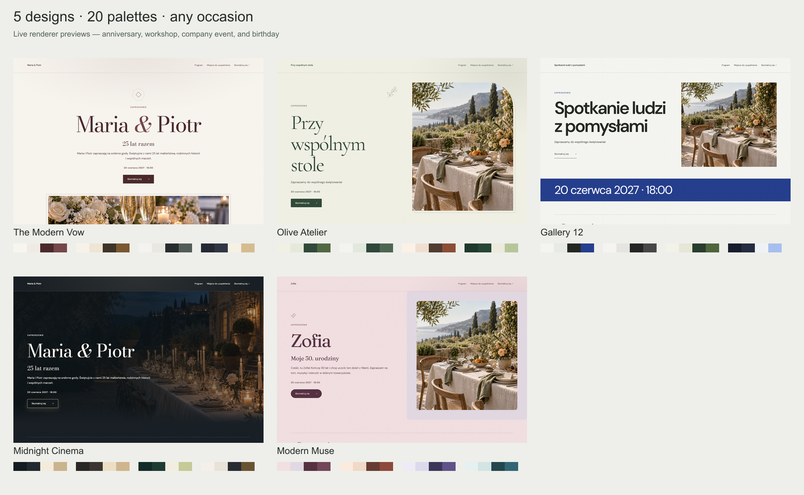
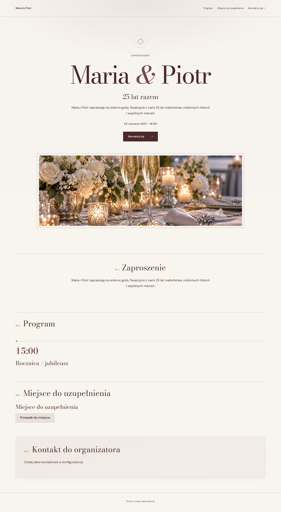
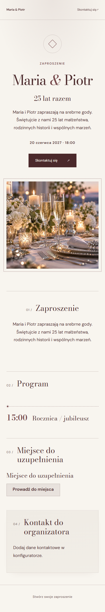

# Themes and palettes

Open **Appearance → Color palette**. Each theme has four palettes. Switching a palette preserves content, photos, crops, layout, decorations, and audience variants. Manual colors remain available and are labeled Custom colors. Clicking the active theme again does not discard custom settings.

| Theme ID | Design | Palettes |
| --- | --- | --- |
| `classic` | The Modern Vow | Porcelain and wine, Champagne, Graphite, Ink |
| `botanical` | Olive Atelier | Olive, Sage, Terracotta, Forest green |
| `editorial` | Gallery 12 | Cobalt, Monochrome, Moss, Night blue |
| `evening` | Midnight Cinema | Midnight, Espresso and champagne, Emerald, Pearl |
| `celebration` | Modern Muse | Pink and plum, Apricot, Lavender, Teal |

All ten populated templates and the blank template can use any theme. Themes do not inject initials, wedding wording, or an ampersand absent from the content. Photos are optional. Device-specific crops and selecting sections from the preview remain available.

RSVP controls follow the theme's typography and colors, while retaining translations, extra questions, answer summaries, and calendar downloads.

## Data and accessibility

The five theme IDs are stable. Configuration stores four colors in `design`; palette recognition compares colors and needs no separate schema field. Loading does not overwrite custom colors. Selecting a different theme applies its default palette, decoration settings, and hero layout while keeping content.

Light/dark presentation follows the background color, not the theme name. Built-in palettes are tested for at least 4.5:1 text/accent contrast on both backgrounds. Custom configuration validation checks text at 4.5:1 and accent at 3:1 against the page background; arbitrary custom colors and photographs still need visual review. Date-strip text is selected against the accent color; photo overlays use a dark gradient.

## Previews and tests

| Desktop (1440 px) | Mobile (390 px) |
| --- | --- |
|  |  |

`tests/themes.test.ts` covers contrast, template/language/palette combinations, and configuration round trips. Browser tests cover palette selection, content preservation, images, mobile/desktop layouts, and horizontal overflow.

After running `tests/e2e/design-examples.spec.ts`, run `npx tsx scripts/build-theme-designs.ts` to refresh `assets/theme-designs/index.html`. Those images show the application renderer. `assets/theme-redesign` contains earlier design proposals and image sources, not a production deployment.
